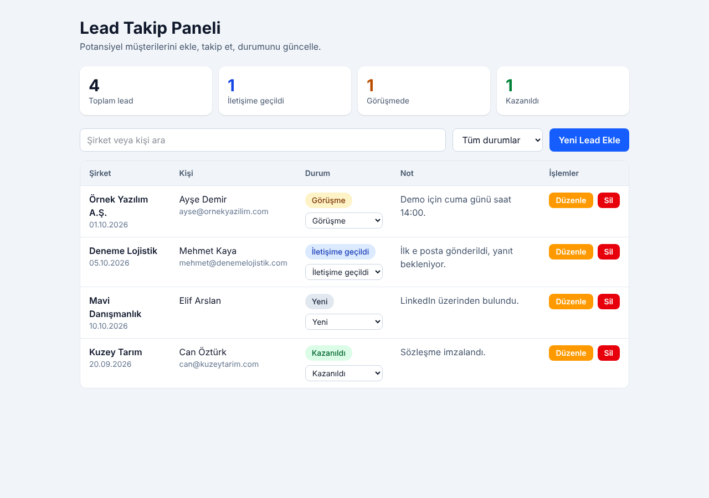

# Lead Takip Paneli

Potansiyel müşterileri (lead) ekleyip takip edebildiğin, durumlarını güncelleyebildiğin küçük bir CRM paneli. Web Geliştirme dersi proje ödevi için hazırlandı.



## Özellikler

1. **Ekle:** Şirket, kişi, e posta, durum ve not ile yeni lead eklenir. Zorunlu alan ve e posta doğrulaması vardır.
2. **Listele:** Tüm leadler tabloda görünür. Şirket veya kişi adına göre arama ve duruma göre filtre vardır. Üstte özet kartları yer alır.
3. **Güncelle:** Durum tablodan tek tıkla değiştirilir, diğer alanlar "Düzenle" penceresinden güncellenir.
4. **Sil:** "Sil" butonu onay penceresi açar, onaylanınca kayıt silinir.

Veriler tarayıcının localStorage alanında saklanır, sayfa yenilense de kaybolmaz. Sunucu gerekmez.

## Kullanılan teknolojiler

1. React 19 ve TypeScript
2. Vite
3. Tailwind CSS 4
4. localStorage (için özel bir `useLocalStorage` hook'u)

## Klasör yapısı

```
src/
  components/   LeadForm, LeadTable, StatusBadge, ConfirmDialog
  pages/        LeadsPage
  interfaces/   lead.ts
  hooks/        useLocalStorage.ts
  App.tsx
  main.tsx
```

## Kurulum ve çalıştırma

```bash
npm install
npm run dev
```

Uygulama http://localhost:5173 adresinde açılır.

Yayın için derleme:

```bash
npm run build
```

Çıktı `dist` klasörüne yazılır.

## Netlify ile yayına alma

Repo Netlify'a bağlanınca ayarlar `netlify.toml` dosyasından otomatik okunur. Elle girmek gerekirse: build komutu `npm run build`, yayın klasörü `dist`.
